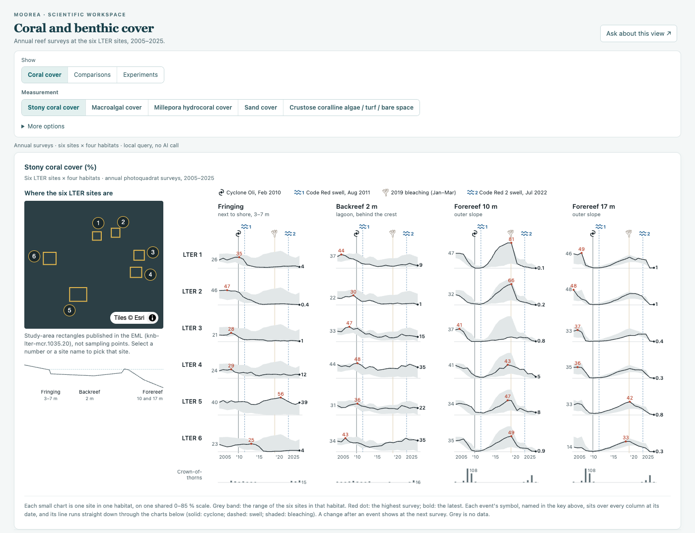
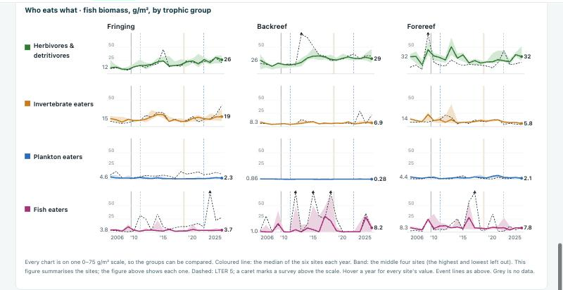
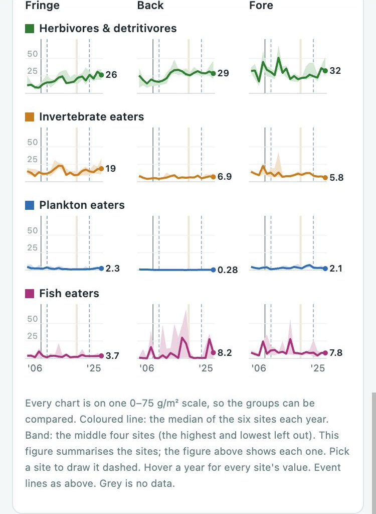

# Moorea Data Explorer: engineering excerpt

The Moorea Data Explorer is a web application for looking at twenty years of coral reef measurements from the Moorea Coral Reef LTER program: moorings, waves and currents, temperature, satellite sea surface temperature, coral cover, fish and more. It has an AI analyst that answers questions by querying the data, and it runs as a private preview for invited testers.

This repository is an excerpt of that project. The full application is private while data permissions are settled, so this code does not run as an app on its own. What is here is working code lifted from the private repository, with the tests that belong to it.

I'm Nic Jeffress. I designed the product, set its rules, built the evaluation and decided what merged.
I built it with Jeffrey Jeffress. Most of the code was written with AI coding assistants (Claude Code and Codex) under our direction and review.



Stony coral cover at the six long-term sites, one small chart per site and habitat, with the cyclone, swells and bleaching marked on every column.

| Fish biomass by what the fish eat | The same figure on a phone |
|---|---|
|  |  |

The data in these figures are CC BY 4.0; the [data notice](DATA-NOTICE.md) cites each package.

## What is here

| Area | Where | What it shows |
|---|---|---|
| AI analyst | `backend/analyst_*.py` | One analyst over two providers (Anthropic and OpenAI) and eight models, with a model table, prices, effort settings and per-call cost accounting |
| Analyst tools | `backend/timeseries.py`, `backend/sampling.py`, `backend/time_range.py` | Tools the model calls to compare periods, resample a series and describe when a table has values |
| Answer check | `backend/answer_check.py` | A last check on the final answer that appends a fixed correction instead of paying for a second model call |
| Prompt | `site/system-prompt.md` | Two sections of the analyst's system prompt |
| Spending limits | `backend/preview_analyst.py` | A ledger that reserves money before each model call and enforces a monthly budget and per-tester daily and monthly ceilings |
| Sign-in | `backend/preview_access.py`, `backend/preview.py` | Verifies Cloudflare Access tokens and an invited-tester list before any page or data is served |
| Evaluation | `evals/analyst-models/` | Question sets, automatic checks, a blind model judge, runners with a spending cap, and saved results |
| Release tooling | `scripts/*preview*.py`, `deploy/` | Builds a release with a hash for every file, checks a live deployment, rolls back, and sets up the server |
| Data tooling | `scripts/data_bundle.py`, `scripts/build_edi_entities.py` | Packs and restores a 20 GB data snapshot with checksums; builds scripts that download each package from EDI |

## Evaluation results

These are **pooled development results** from experiments with different prompts, tools, question counts and scoring snapshots. Some questions were rerun more often than others. They describe the development history and do not establish a matched model ranking or the accuracy of the current preview. [Results by experiment, with source commits and tool-list labels](docs/eval-results.md).

| Model | Data-question runs passing all saved checks | Mean cost per saved run |
|---|---:|---:|
| claude-haiku-5-5@medium | 173 of 189 (92%) | $0.0042 |
| claude-opus-5-5@medium | 29 of 30 (97%) | $0.1593 |
| claude-sonnet-5-5@medium | 29 of 30 (97%) | $0.0539 |

The private preview uses Haiku. These historical costs depend on the questions, prompt and tools used in each experiment.

The saved results hold scores, costs, token counts and timings for 719 execution records. First-answer extracts used by the judge are omitted because they duplicate records in the full experiment files. Scores are preserved as saved; the scorer revision was not recorded. Each experiment includes a score-snapshot hash and each record has a stable ID. Model answers are not published.

## Running the tests

Tested with **Python 3.14.10** and the pinned dependencies below. Use Python 3.14 for these commands.

```sh
python3.14 -m venv .venv
.venv/bin/pip install -r requirements.lock.txt
.venv/bin/python -m unittest discover -s tests
```

75 tests cover the provider adapters, the spending ledger, sign-in and the data bundle. The evaluation runners and the analyst tools need the private data library, so they are here to read, not to run.

## Data and licence

The code is under the [MIT licence](LICENSE). No dataset is included; see the [data notice](DATA-NOTICE.md) for who the data belong to and how to cite them.
